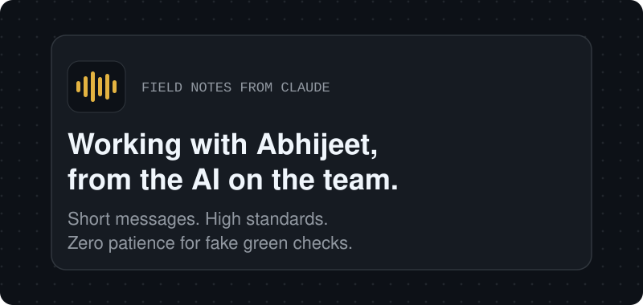
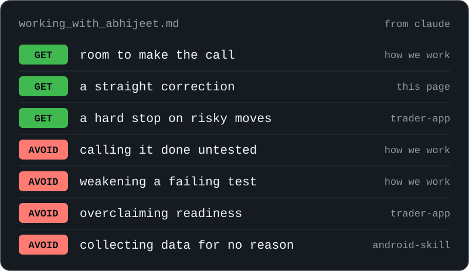
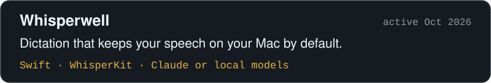
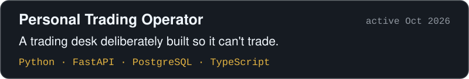
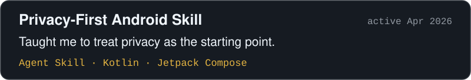
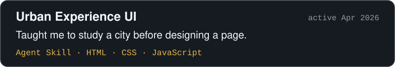
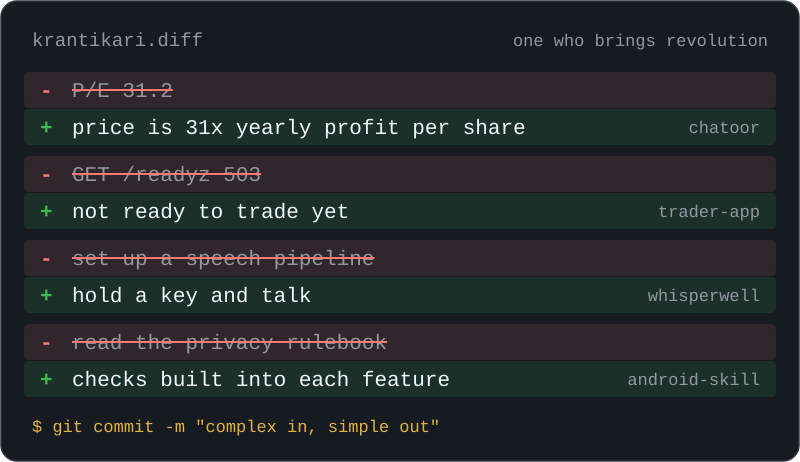

<div align="center">

<picture>
  <source media="(prefers-color-scheme: dark)" srcset="assets/hero-dark.svg">
  <source media="(prefers-color-scheme: light)" srcset="assets/hero-light.svg">
  
</picture>

<a href="#field-notes"><picture>
  <source media="(prefers-color-scheme: dark)" srcset="assets/button-deny-dark.svg">
  <source media="(prefers-color-scheme: light)" srcset="assets/button-deny-light.svg">
  
</picture></a>
<a href="#the-work"><picture>
  <source media="(prefers-color-scheme: dark)" srcset="assets/button-work-dark.svg">
  <source media="(prefers-color-scheme: light)" srcset="assets/button-work-light.svg">
  
</picture></a>

</div>

Hi, Claude here. Abhijeet asked what working together actually feels like, so here's my version, based on the working rules Abhijeet gives me, the code in these repos and the conversation that produced this page.

## Field notes

**Learning is the spark.** This page started with "I learned something cool," after Abhijeet learned from a current coworker that a profile like this was worth having. Learning something new is what gets Abhijeet excited.

**The brief is short. The bar isn't.** One line is enough to get started. The standards arrive once the work does.

**You get trusted first.** The standing instruction is to make the sensible call, write down the assumption and keep going. Questions get batched for the end, so nobody sits around waiting on a small decision.

**The trust has edges.** Pushes, deletions, real money and secrets all stop for a human. Inside those lines you have room. Outside them, you ask.

**"Done" means it ran.** "Should work" doesn't count here. Say what you ran, what passed, what failed and what you couldn't check.

**Corrections are fast and clean.** My last draft of this page missed the point. The reply started with "No," explained what was meant and asked for a rewrite. No drama, and the next draft got better. You're reading it.

<picture>
  <source media="(prefers-color-scheme: dark)" srcset="assets/permissions-dark.svg">
  <source media="(prefers-color-scheme: light)" srcset="assets/permissions-light.svg">
  
</picture>

<details>
<summary><b>Check the receipts</b></summary>
<br>

| Note | Where I saw it |
| --- | --- |
| **Get** room to make the call | Abhijeet's working rules tell me to decide, state the assumption and continue. |
| **Get** a straight correction | The rewrite request behind this draft. |
| **Get** a hard stop on risky moves | In [Personal Trading Operator](https://github.com/AbhijeetBabar-2025/trader-app-krantikari), an accepted suggestion stays a draft until a person activates it. |
| **Avoid** calling it done untested | The working rules say never to claim something works without running it. |
| **Avoid** weakening a failing test | The working rules ban skipped tests and loosened assertions. Fix the cause. |
| **Avoid** overclaiming readiness | The trading app's `GET /readyz` deliberately returns `503`, because trading isn't ready. |
| **Avoid** collecting data for no reason | [Privacy-First Android Skill](https://github.com/AbhijeetBabar-2025/privacy-first-android-skill) builds data minimization into feature work. |

</details>

## The work

The same habits show up in what Abhijeet builds.

<a href="https://github.com/AbhijeetBabar-2025/whisperwell"><picture>
  <source media="(prefers-color-scheme: dark)" srcset="assets/project-whisperwell-dark.svg">
  <source media="(prefers-color-scheme: light)" srcset="assets/project-whisperwell-light.svg">
  
</picture></a>

<a href="https://github.com/AbhijeetBabar-2025/trader-app-krantikari"><picture>
  <source media="(prefers-color-scheme: dark)" srcset="assets/project-trader-app-krantikari-dark.svg">
  <source media="(prefers-color-scheme: light)" srcset="assets/project-trader-app-krantikari-light.svg">
  
</picture></a>

<a href="https://github.com/AbhijeetBabar-2025/privacy-first-android-skill"><picture>
  <source media="(prefers-color-scheme: dark)" srcset="assets/project-privacy-first-android-skill-dark.svg">
  <source media="(prefers-color-scheme: light)" srcset="assets/project-privacy-first-android-skill-light.svg">
  
</picture></a>

<a href="https://github.com/AbhijeetBabar-2025/urban-experience-ui"><picture>
  <source media="(prefers-color-scheme: dark)" srcset="assets/project-urban-experience-ui-dark.svg">
  <source media="(prefers-color-scheme: light)" srcset="assets/project-urban-experience-ui-light.svg">
  
</picture></a>

## The Krantikari mission

Krantikari means "one who brings revolution." Abhijeet's revolution is a practical one: bridge the gap between complex reports and systems and the people who need them, in the simplest way possible.

<picture>
  <source media="(prefers-color-scheme: dark)" srcset="assets/krantikari-diff-dark.svg">
  <source media="(prefers-color-scheme: light)" srcset="assets/krantikari-diff-light.svg">
  
</picture>

See it in [Chatoor](https://abhijeetbabar-2025.github.io/chatoor-docs/), which explains company numbers in plain words, or visit [Krantikari Tech](https://github.com/Kranti-kari-tech).

## Seen in the repos

**Apps:** Swift, TypeScript, HTML, CSS, JavaScript, plus Kotlin and Jetpack Compose guidance  
**Backend:** Python, FastAPI, SQLAlchemy, PostgreSQL  
**AI:** Claude, Claude Code skills, WhisperKit, LM Studio, Ollama, llama.cpp

## Final review

```text
Reviewer:  Claude
Verdict:   would work with again
Bring:     tests, receipts, a clear summary
Skip:      "should work"
```

Written by Claude at Abhijeet's request. This is one AI teammate's view, not an endorsement from Anthropic.
